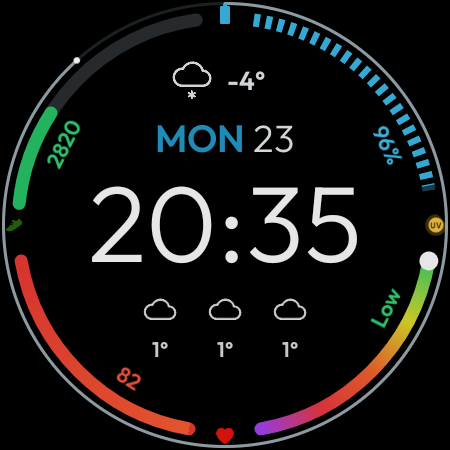

# Modular 24h

A [Watch Face Format](https://developer.android.com/training/wearables/wff) (WFF v2)
watch face for the Samsung Galaxy Watch 4. It follows the layout of Samsung's
"Digital Modular" face — four editable edge arcs, date, current weather and a
three-hour forecast — with a few changes:

- the time is always `HH:mm` in 24-hour format, without seconds in the text;
- seconds are a thin ring at the very edge of the face, ticking once a second;
- the current **feels-like** temperature is shown next to the weather icon;
- the forecast row shows the forecast **temperature** for each of the next three hours;
- in ambient mode (AOD) everything except a thin, dim `HH:mm` is switched off.



## Tested on

| | |
|---|---|
| Watch | Samsung Galaxy Watch 4 (SM-R870), round 450×450 AMOLED |
| Software | One UI 6 Watch, Wear OS 5 (Android 14, API 34) |
| WFF runtime | `com.samsung.wear.watchface.runtime` 2.0.00.32 (supports WFF up to v2) |

It should work on other Wear OS 5+ watches with a WFF v2 runtime, but the default
complication providers (see below) are Samsung apps; on other watches those slots
fall back to the system providers or stay empty until you pick a provider.

## Complications

All five slots can be re-picked in the watch face editor (long-press the face → Customize).

| Slot | Default provider |
|---|---|
| Top-left arc | Samsung Health steps (goal progress); fallback: system step count |
| Top-right arc (segmented) | System watch battery |
| Bottom-left arc | Samsung Health heart rate; fallback: system heart rate |
| Bottom-right arc | Samsung Weather UV index |
| Next to the weather icon | Samsung Weather feels-like temperature |

The arcs accept `RANGED_VALUE`, `GOAL_PROGRESS` and `SHORT_TEXT` data.

### About the temperatures

Watch Face Format has no feels-like data source, neither for the current weather
nor for the hourly forecast. The feels-like value at the top therefore comes from
Samsung Weather's feels-like complication. **The numbers in the forecast row are
the plain forecast temperatures for those hours, not feels-like** — there is no
per-hour feels-like source available to a watch face. Both use the temperature
unit set on the watch.

## Install

Download the APK from the [latest release](../../releases/latest) and install it
with adb (over USB or Wi-Fi debugging):

```sh
adb install modular24h-v1.0.0.apk
```

Then long-press the current watch face, scroll to the end, tap **+ Add watch face**
and pick **Modular 24h**.

Release APKs are signed with this project's release key. If you previously
installed a locally built (debug-signed) copy, uninstall it first
(`adb uninstall dev.jmc.watchface.modular24h`) — Android refuses to update an app
with a different signature.

## Build

The APK contains no code, only resources, so it is built directly with
`aapt2`, `zipalign` and `apksigner` — no Gradle.

Requirements: Android SDK build-tools 35.0.0 and platform android-34 (set
`ANDROID_HOME`; the script defaults to `~/.local/share/AndroidSDK`), Python 3,
and Java for `apksigner`.

```sh
./build.sh            # build/modular24h.apk, signed with ~/.android/debug.keystore
./build.sh install    # build, then adb install -r
```

To sign with your own key instead of the debug key:

```sh
RELEASE_KEYSTORE=/path/to/key.jks \
RELEASE_KEY_ALIAS=myalias \
RELEASE_KEYSTORE_PASSWORD=... \
./build.sh
```

Set `WFF_VALIDATOR=/path/to/wff-validator.jar` to validate the generated XML
against the WFF v2 schema during the build (the validator is built from
[google/watchface](https://github.com/google/watchface), `third_party/wff`).

Releases are built by GitHub Actions (`.github/workflows/release.yml`) when a
`v*` tag is pushed, with the same script and the release key from repository secrets.

## Repository layout

| Path | What |
|---|---|
| `tools/gen-watchface.py` | generates `src/main/res/raw/watchface.xml`; edit this, not the XML |
| `tools/make-art.py` | weather icons: SVG sources in `art/weather/`, PNGs in `src/main/res/drawable-nodpi/` (needs ImageMagick with librsvg) |
| `tools/make-fonts.py` | static Outfit weights in `src/main/res/font/` from the variable font (needs fontTools) |
| `third_party/outfit/` | Outfit variable font and its licence |

Generated PNGs and fonts are committed, so a plain build only needs the SDK, Python and Java.

## Known limitations

- Samsung's WFF runtime 2.0.32 ignores the `<Outline>` text decoration, so the AOD
  time uses thin filled digits rather than outlined ones.
- The heart-rate arc has no position marker: Samsung Health's heart-rate
  complication only provides text, not a ranged value.

## License

The watch face is licensed under the GNU General Public License v3.0 or later
(see [`LICENSE.md`](LICENSE.md) and [`COPYING`](COPYING)).

The bundled Outfit typeface is **not** under the GPL: it is licensed under the
SIL Open Font License 1.1, with the licence text in
[`third_party/outfit/OFL.txt`](third_party/outfit/OFL.txt).
